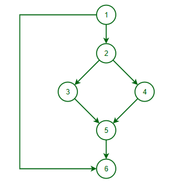

# Test Case Analysis - Control Flow Testing

## Introduction

Control flow testing falls under the white-box software testing techniques. It's goal is to test the logical flow of a software program's code. The test cases would try to cover every possible path through the code making sure to run through every single if statement, loop, and other conditional paths to identify any errors that may occur in the logic, like creating infinite loops or having code that is unreachable.

## Table / Diagram Example

Notice how this diagram looks a lot like a normal flow chart for a program. That's because this testing uses the flow of the program to model the test cases.

## When Testing Should Occur

Although programmers aren't really supposed to be the only ones testing their code, this test would be great for the programmer to use if they had to test their own code. The reason this test would be great for the programmer is because this is a white-box testing technique that requires the tester to know all the possible paths of the program and how to get them to execute, and no one knows that better than the programmer!

## Limitations

This type of testing might not catch errors relating to data values since it is only testing the flow of the program and not the data that is being pushed through the program. Since it is also a white-box testing technique, testers must be knowledgeable on the coding language and design of the program, so testing might take a little bit longer to train and find people with the correct skill set.

## AI Discussion

- Github Copilot hallucinated a little bit. I asked it for an example of this type of testing in a table or diagram form and it just spit out a random table filled with letters that was kind of confusing. Granted, I think it would've done better if it could provide pictures and not just tables of data.
- Sites used to verify AI output:
    - https://www.geeksforgeeks.org/software-testing/control-flow-software-testing/
    - https://www.geeksforgeeks.org/software-engineering/software-engineering-control-flow-graph-cfg/
- One prompt I used: "What are the limitations of control flow testing?"